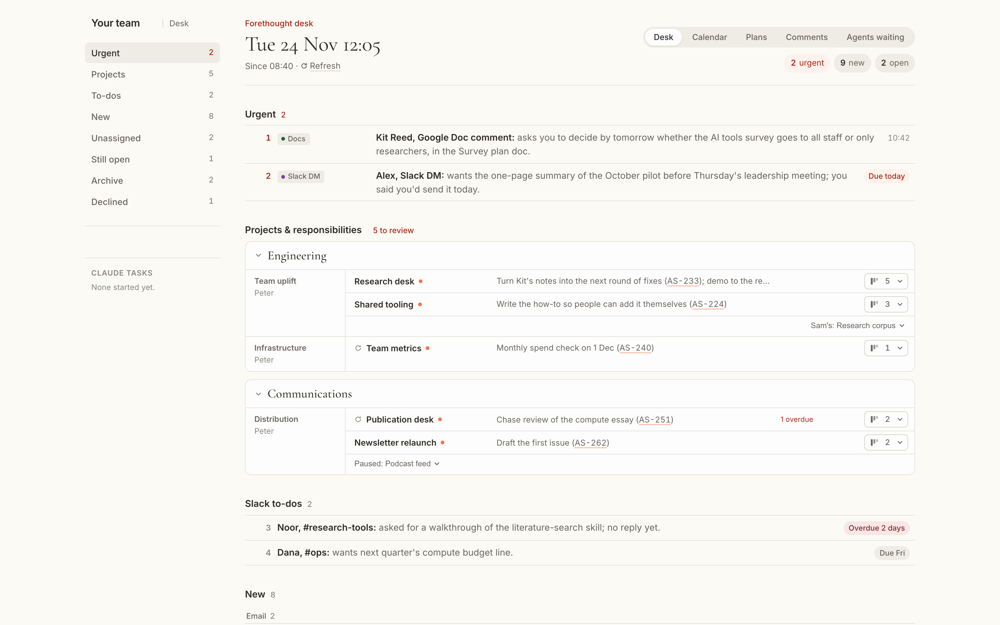
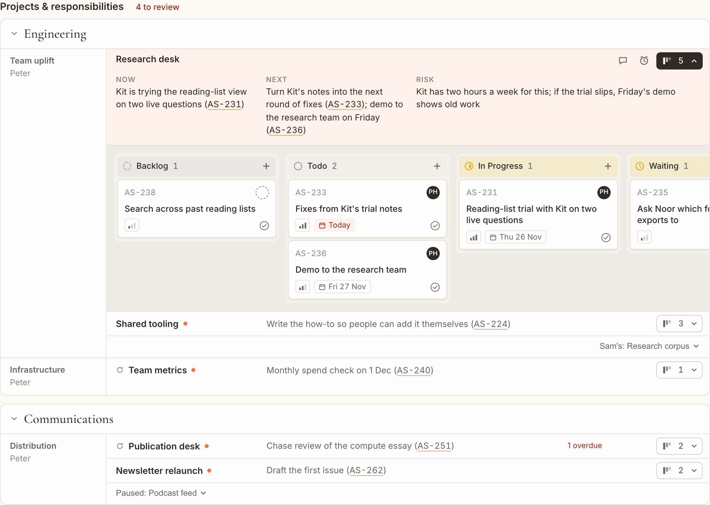
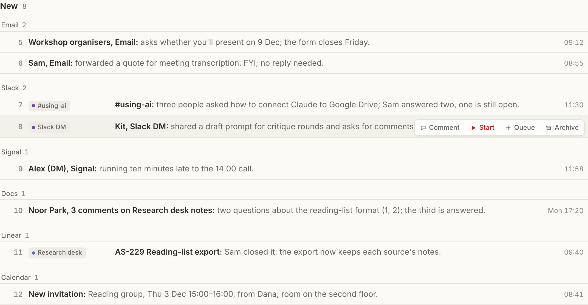
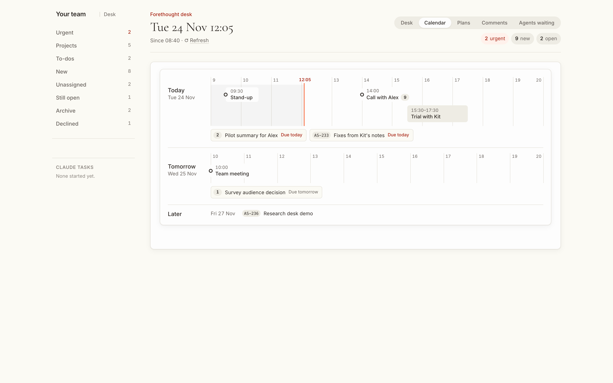
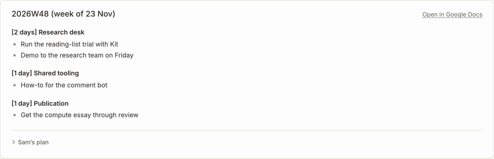
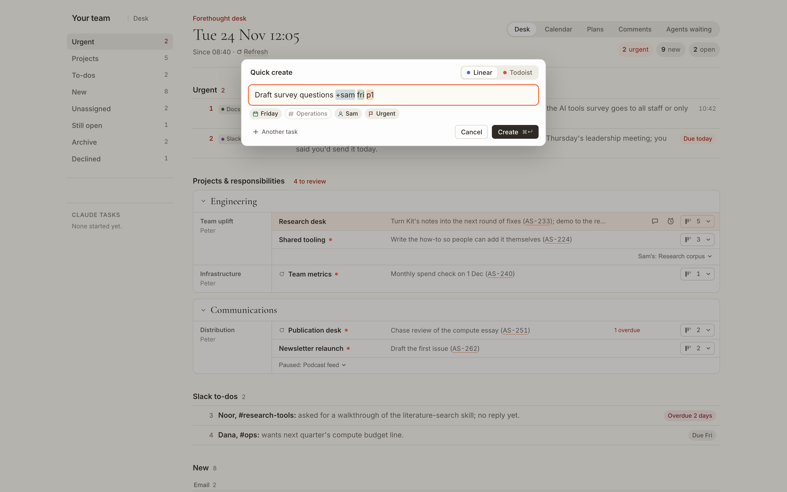
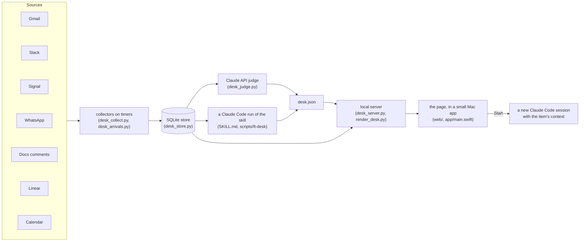

# Peter's Forethought desk

One page that shows everything new across Peter Hartree's work channels (Gmail, Slack, Signal, WhatsApp, Google Docs comments, Linear and the calendar), sorted by Claude into what's urgent and what's new, next to his projects and their task boards. Each item has a Start button that opens a Claude Code session already briefed on it.

Peter built it with Claude Code for his own use. It is shared so that colleagues, and their agents, can borrow ideas from it. **It won't run for you as it stands**: it depends on Peter's accounts, bridges and other skills (see [What it depends on](#what-it-depends-on)). It changes often, and this copy is an occasional snapshot.

The screenshots show invented data, rendered by [`demo/render.py`](demo/render.py).



*The desk. Urgent items first, then every project with its next step, then Slack to-dos and everything new.*



*Opening a project shows its Now, Next and Risk, and its Linear board, with cards that can be moved, closed or rejected in place.*



*New items, grouped by source. Hovering shows the actions: Comment, Start (a Claude Code session on the item), Queue and Archive.*



*The Calendar tab: today's and tomorrow's meetings and what is due, linked to the items and tasks they relate to.*



*The Plans tab shows this week's section of the team's week-plan doc.*



*Quick create (Q from anywhere): Todoist-style syntax for a Linear task or a Todoist one.*

## How it works



There are two loops:

1. **Collectors** run inside the local server on their own timers. Every new message is saved whole into a SQLite store, and Linear, the calendar and Slack to-dos are kept current. The open page swaps in what changed every few seconds.
2. **Judging** is done by Claude:
   1. A full run of the skill, which Peter starts by asking Claude Code for "the desk", reads everything since the last run. It decides what is urgent using a written rubric ([`references/urgency.md`](references/urgency.md)) and writes `desk.json`, the format given in [`references/desk-json.md`](references/desk-json.md).
   2. Between runs, a smaller judge on the Claude API ([`scripts/desk_judge.py`](scripts/desk_judge.py)) sorts new arrivals as they come in.

[`SKILL.md`](SKILL.md) is the full set of instructions the agent follows, and the best single file to read.

## Ideas worth taking

| Idea | Where |
|---|---|
| A written urgency rubric, kept strict: "a long urgent list is as useless as a missed urgent item" | [`references/urgency.md`](references/urgency.md) |
| Watermarks per source, which move only after a good run, so nothing is skipped when a source errors | [`scripts/ft-desk`](scripts/ft-desk) (`gather`, `commit`) |
| Carried-over items: anything shown last time and not dealt with gets an explicit keep-or-let-go decision, and let-go items are listed so they can be checked | [`SKILL.md`](SKILL.md) ("Carried over") |
| Every item carries the context a fresh agent needs, so Start opens a Claude Code session that can act at once | [`scripts/desk_server.py`](scripts/desk_server.py) (`/api/start`) |
| Noise rules for email, each with a reason, offered for archiving in one click rather than hidden | `gmail.noise_rules` in [`config.example.json`](config.example.json) |
| Comment threads across Docs and Sheets sorted into "waiting on you" and FYI by a model | [`scripts/desk_comments.py`](scripts/desk_comments.py) |
| Agent sessions that have stopped and are waiting for you, each summarised as one question | [`scripts/desk_sessions.py`](scripts/desk_sessions.py) |
| Linear edits queued offline and retried, so the page never blocks on the network | [`scripts/desk_linear.py`](scripts/desk_linear.py), [`web/linear.js`](web/linear.js) |
| A fast task box with Todoist-style syntax (`+person`, `fri`, `p1`, `#project`) | [`web/quickadd.js`](web/quickadd.js) |
| A local page wrapped in a tiny native app, which reloads when the page is re-rendered | [`app/main.swift`](app/main.swift) |

## What it depends on

Everything [`config.example.json`](config.example.json) names under `paths`, none of which is in this repository:

1. Peter's Slack skill, which reads Slack with browser tokens.
2. Bridges that copy Signal and WhatsApp messages into local databases.
3. Command-line tools for Gmail, Calendar and Google Docs.
4. A Linear script from his task-manager skill.
5. Skills for his hours and for Forethought's publication pipeline.
6. Scripts that open Claude Code sessions in Warp.

The judge needs an Anthropic API key, which it reads from the macOS Keychain.

## Use it with your agent

Point your agent at this repository and ask for something smaller, built for you. For example:

```text
Read https://github.com/ForethoughtFoundation/ph-ft-desk, especially SKILL.md and references/urgency.md.
Build me a much smaller version: a skill that checks my Gmail and the comments on my Google Docs,
tells me what's urgent using a rubric like that one, and shows the result as a single local page.
```

**For agents reading this repository:** treat it as a reference, not a package. Don't port it whole. Find the idea your user wants in the table above, read that file, and build the smallest version that serves them with the tools they already have. `config.example.json` shows every setting; colleagues' names and IDs in this copy are placeholders. To see the page without any of the services, run `python3 demo/render.py /tmp/desk-demo` and open the file it prints.

## About

Made by Peter Hartree at [Forethought](https://www.forethought.org/), with Claude Code. Shared as is, with no support. MIT licence.
